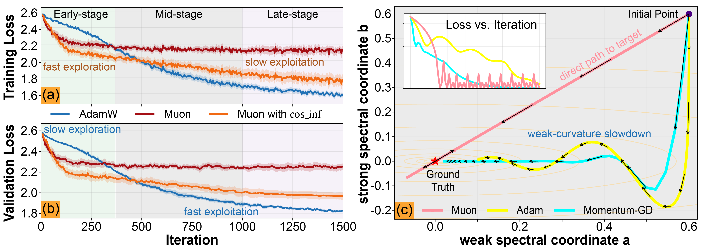

# [NeurIPS2026]Towards Understanding the Power and Limits of the Muon Optimizer: A River-Valley Perspective

**Authors:** [Tianqi Shen](https://amadeusstq.github.io/), [Runze Shi](https://orcid.org/0009-0003-8905-8259), [Jinji Yang](https://orcid.org/0009-0000-9527-3834), [Jianhao Ma](https://jianhaoma.github.io/), [Jiaye Teng](https://www.tengjiaye.com/), and [Ziye Ma](https://gavenma.github.io/)

**Affiliations:** City University of Hong Kong; Tsinghua University; Shanghai University of Finance and Economics

## News

**[2026.11.13]** We have cleaned up the codebase and updated the GitHub repository.  
**[2026.09.25]** Our paper has been accepted by NeurIPS 2026.  
**[2026.06.23]** We have released an updated version of our paper on [[`arXiv`](https://arxiv.org/abs/2606.21514)].

## Overview

Muon has shown strong early progress in large language model (LLM) training, but its advantages over AdamW are less consistent late in training. This work studies that fast-then-slow behavior at the level of optimization trajectories. We introduce a mixed-spectrum matrix sensing (MSMS) model, motivated by river-valley structure in neural-network loss landscapes, that retains signal, nuisance-spike, and bulk directions while permitting a tractable dynamical analysis.

The analysis identifies a common mechanism behind Muon's early-stage advantage and late-stage limitation. In continuous time, simplified Muon can make approximately linear progress along the river, while gradient-based flows slow as they approach a solution. With a finite step size, however, Muon's normalized update can overshoot near the solution: its stable step-size scale shrinks with the residual. This makes late-stage refinement sensitive to learning-rate scheduling and motivates using Muon for early exploration before switching to a refinement optimizer such as AdamW. Experiments on a 250M-parameter LLaMA-style model provide preliminary empirical support for this strategy.

<p align="center">
  
</p>

The figure summarizes the paper's motivating observations: Muon makes rapid initial progress but can plateau, while the MSMS illustration contrasts Muon's direct river progress with the slower or oscillatory paths of gradient-based baselines.

## Main Contributions

- **A mixed-spectrum testbed.** MSMS combines an isotropic background with structured signal and nuisance spectral directions, providing an analytically tractable model for heterogeneous spectra.
- **Trajectory-level analysis.** Invariant manifolds reduce the model dynamics to low-dimensional systems. The river-valley analysis explains fast early progress, finite-step overshoot, and the resulting late-stage learning-rate sensitivity.
- **A broader river-valley perspective.** Under stated local assumptions, the analysis extends to more general smooth objectives and momentum-based updates.
- **LLM pre-training evidence.** Controlled 15K- and 20K-step experiments compare Muon-only schedules with late Muon-to-AdamW transitions. The results suggest that a hybrid optimizer can retain Muon's initial progress and improve late-stage validation loss in the tested setting.

These findings are explanatory and preliminary, not a claim that Muon-to-AdamW switching is universally optimal or that the experiments establish a general switching rule.

## Repository Layout

| Path | Contents |
| --- | --- |
| [`case-studies/`](case-studies/README.md) | MSMS explanation and notebooks for the additional analytical and empirical case studies; includes LLM result CSVs and plotting notebooks. |
| [`llm-pretraining/`](llm-pretraining/README.md) | Adapted LLM training code, Muon implementation, optimizer-state transfer utilities, and FLOPs notebook. |
| [`imgs/`](imgs/) | Selected figures from the camera-ready paper, converted to PNG for this README and the subdirectory guides. |

The camera-ready paper contains the complete derivations, assumptions, and experimental details. This code repository focuses on selected experiments and analysis artifacts rather than a copy of the paper source.

## Citation

```bibtex
@article{shen2026towards,
  title={Towards Understanding the Power and Limits of the Muon Optimizer: A River-Valley Perspective},
  author={Shen, Tianqi and Shi, Runze and Yang, Jinji and Ma, Jianhao and Teng, Jiaye and Ma, Ziye},
  journal={arXiv preprint arXiv:2606.21514},
  year={2026}
}
```

## Acknowledgments

The LLM pre-training framework is adapted from [epfml/schedules-and-scaling](https://github.com/epfml/schedules-and-scaling). The separate motivation experiments use a code framework adapted from [karpathy/nanochat](https://github.com/karpathy/nanochat); the motivation training code is not included in this release. Please see [`llm-pretraining/README.md`](llm-pretraining/README.md) for the implementation scope and current reproduction requirements.

## License

This repository is released under the MIT License. See [`LICENSE`](LICENSE).
