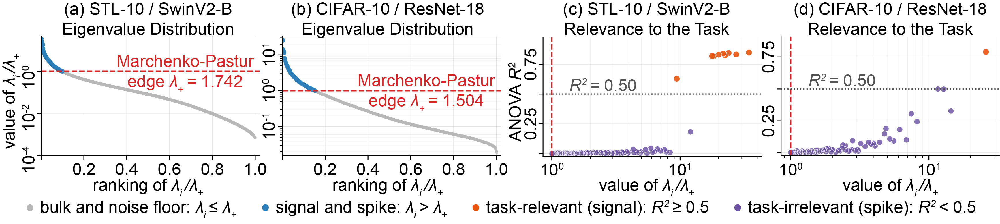
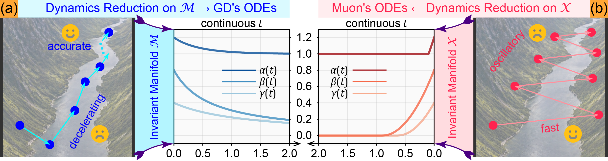

# Case Studies

This directory contains notebooks for the experiments and visual analyses accompanying *Towards Understanding the Power and Limits of the Muon Optimizer: A River-Valley Perspective*. The central testbed is the **mixed-spectrum matrix sensing (MSMS)** model. It captures a signal direction, task-irrelevant spectral spikes, and an isotropic bulk while keeping the population objective and optimizer dynamics analytically manageable.

## Mixed-Spectrum Matrix Sensing

Let the ambient space have dimension $n=3r$, and let $P_\star$, $P_\diamond$, and $P_\circ$ be mutually orthogonal rank-$r$ projectors. They represent, respectively, the target-aligned signal, nuisance spikes, and bulk or residual directions. A random sensing matrix is drawn as

$$
A = G + \pi_\star P_\star + \pi_\diamond P_\diamond + \pi_\circ P_\circ,
\qquad G\sim\mathrm{GOE}(n),\qquad \pi\sim\mathcal{N}(0,\Sigma),\quad \Sigma\succeq 0.
$$

For a factor $X$, the target is $P_\star$ and the population objective is

$$
\mathcal{L}(X)=\frac{1}{2}\mathbb{E}\left[\left\langle A,XX^\top-P_\star\right\rangle^2\right].
$$

The associated population loss for $M=XX^\top$ can be written as

$$
\mathcal{F}(M)=\frac{1}{n}\lVert M-P_\star\rVert_F^2+
\frac{1}{2}
\begin{bmatrix}
\langle P_\star,M-P_\star\rangle\\
\langle P_\diamond,M\rangle\\
\langle P_\circ,M\rangle
\end{bmatrix}^{\!\top}
\Sigma
\begin{bmatrix}
\langle P_\star,M-P_\star\rangle\\
\langle P_\diamond,M\rangle\\
\langle P_\circ,M\rangle
\end{bmatrix}.
$$

The model has invariant manifolds for vanilla gradient descent and simplified Muon. On the GD manifold,

$$
M=\alpha P_\star+\beta P_\diamond+\gamma P_\circ,
\qquad
f(\alpha,\beta,\gamma)=\frac{1}{2}z^\top\widehat Kz,
\quad z=(\alpha-1,\beta,\gamma)^\top,
\quad \widehat K=\frac{2r}{n}I_3+r^2\Sigma.
$$

The Muon factor manifold maps to the same reduced coordinates through $X=[aU\;bV\;cW]$, with $(\alpha,\beta,\gamma)=(a^2,b^2,c^2)$. These reductions expose the river (signal progress) and hill (transverse nuisance) dynamics. In the regimes and under the assumptions analyzed in the paper, Muon can progress rapidly along the river, while a fixed finite step can overshoot near the solution; gradient-based updates can be slower initially but continue to refine at late stages.

The motivation for the mixed-spectrum structure is supported by feature-covariance measurements in vision models: eigenvalues above an isotropic Marchenko-Pastur reference include both task-relevant directions and task-irrelevant spikes.

<p align="center">
  
</p>

The following figure illustrates the invariant-manifold reduction and the contrasting continuous-time trajectories of GD and simplified Muon.

<p align="center">
  
</p>

## Included Studies

| Notebook | Study |
| --- | --- |
| [`empirical_evidence_in_image_representation.ipynb`](empirical_evidence_in_image_representation.ipynb) | Feature-covariance spectra and task relevance for image representations; supports the mixed-spectrum motivation. |
| [`two_dim_spectral_slice_case.ipynb`](two_dim_spectral_slice_case.ipynb) | Two-dimensional anisotropic quadratic slice comparing momentum-GD, Adam, Muon, and Muon-to-GD/Adam hybrids. |
| [`mixed_spectrum_ms_diag_case.ipynb`](mixed_spectrum_ms_diag_case.ipynb) | Decoupled diagonal MSMS dynamics, including continuous and discretized trajectories and a Muon-to-GD hybrid. |
| [`mixed_spectrum_ms_psd_case.ipynb`](mixed_spectrum_ms_psd_case.ipynb) | Coupled dynamics for a general PSD interaction matrix, with pure GD, pure Muon, and Muon-to-GD comparisons. |
| [`two_layer_neural_network_case.ipynb`](two_layer_neural_network_case.ipynb) | Two-layer ReLU network on MNIST, comparing momentum-GD, Adam, Muon, and a Muon-to-Adam hybrid. |

The appendix case studies are diagnostic examples, not a broad benchmark across architectures or datasets. In particular, fixed-step toy experiments illustrate both fast early progress and possible late oscillation; their settings and limitations are described in the camera-ready paper.

## LLM Result Data and Plotting

The [`llm_pretrain_lr_scheduler/`](llm_pretrain_lr_scheduler/) directory contains the training/validation CSV exports for the LLM pre-training scheduler and optimizer-switching experiments, as well as the Shakespeare motivation experiment. The notebooks [`llm_pretrain_lr_scheduler.ipynb`](llm_pretrain_lr_scheduler.ipynb) and [`llm_pretrain_motivation.ipynb`](llm_pretrain_motivation.ipynb) load these CSVs to produce figures; they are analysis/plotting notebooks, not the training programs. The LLaMA pre-training implementation and its current reproduction scope are documented in [`../llm-pretraining/README.md`](../llm-pretraining/README.md).

To run the plotting notebooks with their relative CSV paths, start Jupyter from this directory:

```bash
cd case-studies
jupyter lab
```

The analytical notebooks use Python with NumPy and Matplotlib. The image and MNIST studies additionally use PyTorch and torchvision. The plotting notebooks use pandas and Matplotlib; the motivation plotting notebook also uses seaborn. Dataset downloads may be required for the image and MNIST notebooks.
