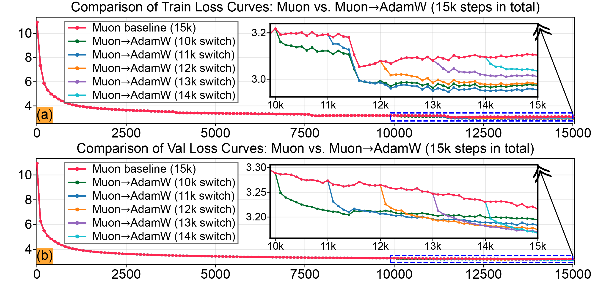
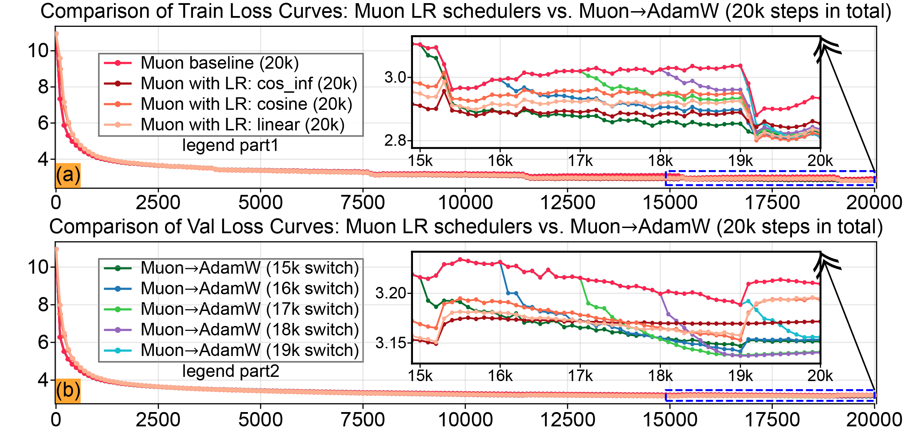

# LLM Pre-training Experiments

This directory contains the adapted training code and optimizer utilities for the main-text and appendix LLM pre-training experiments in *Towards Understanding the Power and Limits of the Muon Optimizer: A River-Valley Perspective*.

## Experimental Setup

We train a 250M-parameter LLaMA-style Transformer from scratch on a fixed approximately 250M-token subset of OpenWebText2. All optimizer variants use the same train/validation split and controlled data-reading protocol. The paper reports 15K- and 20K-step runs. Experiments used four NVIDIA RTX PRO 6000 GPUs (96 GB each), batch size 16 per process, seed 0, data seed 1337, weight decay 0.1, and gradient clipping at 1.0; train and validation metrics were evaluated every 100 steps using 32 validation batches.

The comparisons include Muon-only runs with constant or decaying learning-rate (LR) schedules and two-stage runs that use Muon first, then switch to AdamW. The optimizer handoff warm-starts AdamW's state from calibration gradients and the stored Muon momentum. It is an approximate transfer, not a reconstruction of the AdamW moments that would have been accumulated from the start.

## Results

The 15K-step comparison uses a fixed-LR Muon baseline and Muon-to-AdamW runs switching at 10K, 11K, 12K, 13K, or 14K steps. In the tested setting, the hybrid runs improve validation loss over the Muon baseline; later switches generally perform better within the tested window.

  

The 20K-step comparison includes Muon-only constant, linear, cosine, and `cos_inf` schedules, together with Muon-to-AdamW switches at 15K, 16K, 17K, 18K, or 19K. The tested hybrid configurations show clearer gains in validation than in training loss. The 17K- and 18K-step switches achieve lower final validation losses than the earlier tested switches; a 19K switch has less time for AdamW refinement. In this experiment the best-performing hybrid configurations use `cos_inf` during the AdamW phase. These observations are specific to the reported model, data subset, budget, and hyperparameters.

  

The figures above are the paper's training/validation plots. The validation-only comparison from the main text is also discussed in the paper. Raw CSV exports and plotting notebooks are in [`../case-studies/`](../case-studies/README.md).

## Code Provenance and Scope

The training framework is adapted from [epfml/schedules-and-scaling](https://github.com/epfml/schedules-and-scaling). This directory contains the adapted model, training loop, Muon implementation, optimizer-state transfer utilities, configuration, and a FLOPs notebook. In particular, [`src/optim/state_transfer.py`](src/optim/state_transfer.py) implements the Muon momentum to AdamW/SGD state transfer, and [`src/optim/base.py`](src/optim/base.py) integrates that transfer into the training loop.

The **motivation** experiment on Tiny Shakespeare uses a framework adapted from [karpathy/nanochat](https://github.com/karpathy/nanochat). Its CSV results and plotting notebook are included under `../case-studies/`, but the motivation training code is **coming soon and is not included in this release**.

## Reproduction Status

The LLM training entry point is [`src/main.py`](src/main.py). The full training data and checkpoints are not included. Also, the current repository snapshot does not include the `src/data/` package imported by `src/main.py` (`data.utils`), nor the dataset preprocessing scripts. As a result, this snapshot is **not self-contained for launching pre-training**. Restore the corresponding data-loading and preprocessing components from the adapted upstream framework, and prepare the fixed OpenWebText2 subset, before attempting to run the experiments. We intentionally do not provide a launch command here that would fail against the current snapshot.

The included [`requirements.txt`](requirements.txt) pins PyTorch 2.2.0 with CUDA 11.8, but it should not be treated as a complete environment specification for every training or plotting workflow. The experiments were run in a CUDA environment; GPU memory, distributed setup, dataset preparation, checkpoint availability, and the exact configuration all affect reproduction.

## Plotting the Released Results

For plots reconstructed from the released CSV exports, see [`../case-studies/llm_pretrain_lr_scheduler.ipynb`](../case-studies/llm_pretrain_lr_scheduler.ipynb). Its relative paths expect the notebook to be launched with `case-studies/` as the working directory; see [`../case-studies/README.md`](../case-studies/README.md).

## Citation

If you use this code or these results, please cite the paper using the BibTeX entry in the [repository README](../README.md#citation).
